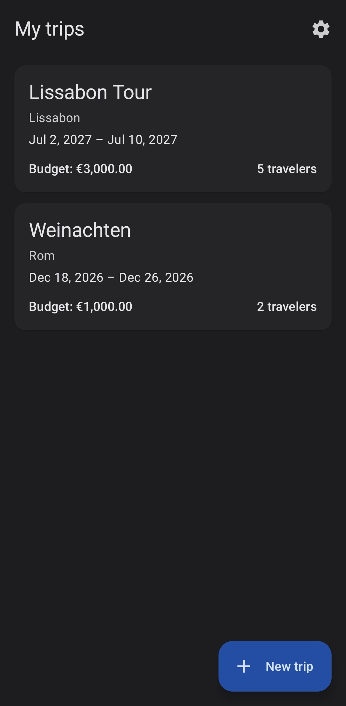
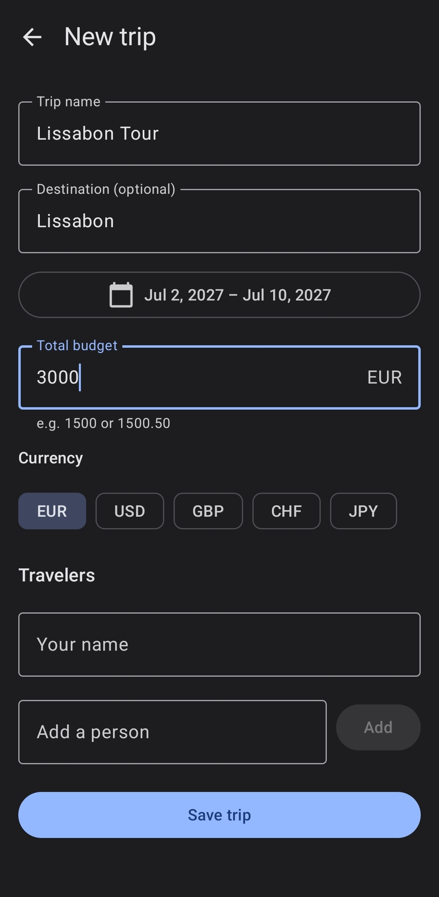
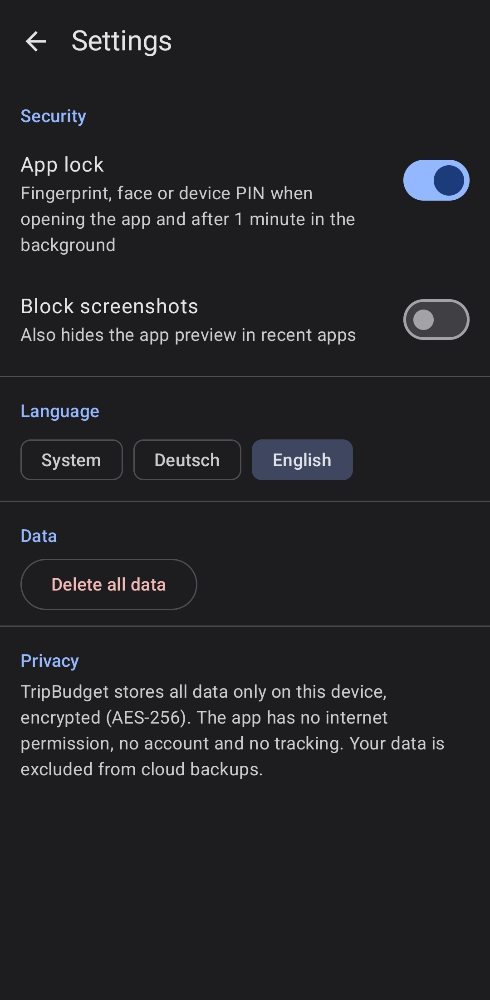

# TripBudget

[](https://github.com/NicoPaduraru/tripbudget/actions/workflows/android.yml)

An offline Android app for planning group trips and splitting travel costs fairly.
Built with Kotlin and Jetpack Compose as a portfolio project. No account, no server, no tracking: all data stays encrypted on the phone.

**[Download the latest APK](https://github.com/NicoPaduraru/tripbudget/releases/latest)** (Android 8.0+)

## Screenshots

| Trips | Day plan | Expenses |
|:---:|:---:|:---:|
|  |  |  |

| Settle up | Add expense | Settings |
|:---:|:---:|:---:|
|  |  |  |

## Features

- **Trips**: dates, budget, currency and fellow travelers
- **Day-by-day plan**: activities with time, place and planned cost; one tap turns an activity into a pre-filled expense
- **Expenses**: amount, category, date, who paid, split between whom (cent-exact even split)
- **Budget overview**: remaining budget, daily budget, planned costs, warning at 80 %
- **Settle up**: per-person balances and suggested transfers (at most n − 1), mark as paid / undo
- **English and German**, language switch inside the app (Android 13+)
- **Privacy & security**: encrypted database, app lock, screenshot protection, delete all data

## Tech stack

Kotlin · Jetpack Compose · Material 3 · Navigation Compose · Room · SQLCipher · DataStore · BiometricPrompt ·
Coroutines & Flow · MVVM · Hilt · JUnit · R8 · GitHub Actions

## Architecture

```
ui/      Compose screens + ViewModels (unidirectional data flow, one UiState per screen)
domain/  Pure Kotlin: models, validation, cost splitting, budget and settlement logic, repository interfaces
data/    Room entities and DAOs, SQLCipher encryption, DataStore settings, repository implementations
di/      Hilt modules (database, repositories, clock, app lock)
```

- The **domain layer has no Android dependencies**, so all business rules are covered by fast JVM unit tests (76 tests).
- Money is stored as **minor units (`Long`)**, never as floating point; rounding remainders are distributed cent by cent.
- Time is injected as a `java.time.Clock`, so date-dependent logic is testable.
- Database schema is versioned (v1 → v4) with a hand-written migration and Room auto-migrations.

## Security & privacy

- **Encrypted database**: SQLCipher (AES-256) with a random 256-bit passphrase, itself encrypted by an Android Keystore key (AES-GCM)
- **Lossless migration** of older plaintext databases (`sqlcipher_export`)
- **App lock** with BiometricPrompt (biometrics or device credential), re-locks after 1 minute in the background
- Optional **`FLAG_SECURE`**: no screenshots, hidden in the recent apps screen
- **No internet permission**: the app cannot send data anywhere; `allowBackup=false`
- Release build **shrunk and obfuscated with R8**

## Build

Requirements: Android Studio (AGP 9.4), JDK 25 for Gradle (downloaded automatically).

```bash
./gradlew testDebugUnitTest   # unit tests
./gradlew assembleDebug       # debug APK
```

Every push runs tests and a full R8 release build on GitHub Actions.

## Development history

The app was built step by step, each phase with its own learning notes:

| Phase | Content |
|---|---|
| 0 | Project setup, domain model, cost-splitting engine with tests |
| 1 | Room database, MVVM, trip list and trip creation |
| 2 | Expenses, budget overview, schema migration |
| 3 | Group settlement and transfer suggestions |
| 4 | Day-by-day planner, plan → expense |
| 5a | Security: SQLCipher, Keystore, app lock, settings |
| 5b | Dependency injection with Hilt |
| 6 | R8 release build, CI with GitHub Actions, signed release |

## License

Portfolio project. All rights reserved unless a license file says otherwise.
